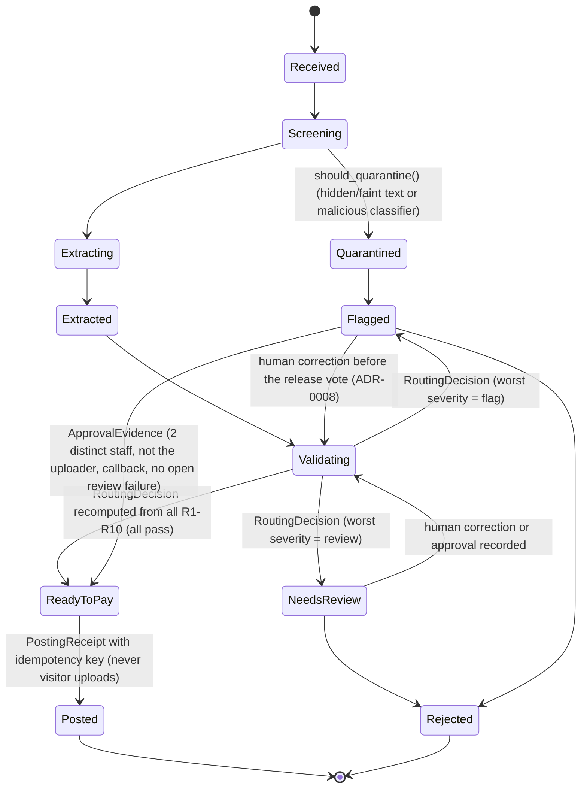
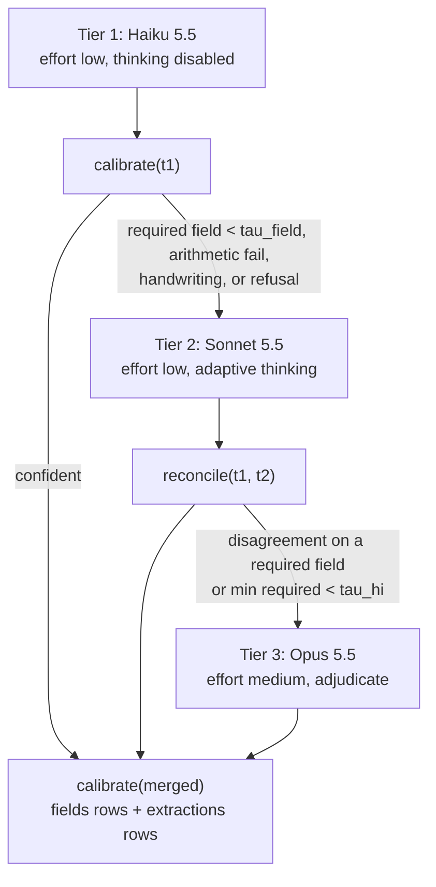

# Architecture

This page is DESIGN [§4.2](../DESIGN-InvoiceDesk.md#42-data-flow-architecture-diagram) and
[§4.3](../DESIGN-InvoiceDesk.md#43-document-state-machine), updated to the modules that were
actually built. The repo layout and import names are in [foundation.md](foundation.md). The
decisions behind each part are in the [ADRs](adr/README.md).

## Components

| Component | Module | Entry point |
|---|---|---|
| Web app (Next.js 15, TypeScript) | `apps/web` | `pnpm --filter web dev` (mock mode needs no API) |
| API gateway (FastAPI) | `apps/api/invoicedesk_api` | `invoicedesk_api.main:app`, `make api` |
| Job queue | `invoicedesk.db.queue.PostgresJobQueue` (`SKIP LOCKED`) | used by the API and worker |
| Worker (LangGraph) | `services/worker/invoicedesk_worker`, `invoicedesk.pipeline.graph` | `invoicedesk-worker`, `make worker` |
| Preprocessor | `invoicedesk.preprocess` (PyMuPDF, Pillow, RapidOCR, imagehash) | `build_preprocessor()` |
| Guardrail screen | `invoicedesk.guardrails` (`hidden_text`, `faint_text`, `classifier`) | `build_screeners()`, `run_screening()` |
| Extractor | `invoicedesk.extract` (`tiers`, `reconcile`, `files_api`, `prompts/`) | `build_extractor()` |
| Calibrator | `invoicedesk.calibrate` (heuristic-v1, or a fitted logistic/isotonic artifact) | `load_calibrator()` |
| Rules engine | `invoicedesk.rules` (`r01_vendor.py` ... `r10_injection.py`, `engine.py`) | `build_rules_engine()`, `make validate` |
| State machine | `invoicedesk.status` (`DocStatus`, `TRANSITIONS`, `transition()`, `route()`) | used by `db.repo.set_status` |
| Posting adapter | `invoicedesk.accounting.quickbooks.QuickBooksAdapter` | `build_accounting_adapter()` |
| Audit log | `invoicedesk.audit` (`append`, `verify`) | `make audit-verify` |
| Claude client | `invoicedesk.llm.anthropic_client` (the only `anthropic` import) | `wiring.llm_client()` |
| Telemetry | `invoicedesk.telemetry` (OTel GenAI spans -> Langfuse OTLP) | `setup_tracing()` |
| MCP server | `services/mcp-server/invoicedesk_mcp` | `invoicedesk-mcp`, `make mcp` |
| n8n | [integrations/n8n/workflows](../integrations/n8n/workflows/README.md) | import the JSON exports |
| Evals | `evals/invoicedesk_evals` | `invoicedesk-eval`, `make eval-offline` |

Offline mode (`INVOICEDESK_MODE=offline`, the default) swaps every external service for a
deterministic stand-in through `invoicedesk.wiring`:

| Port | Offline | Live |
|---|---|---|
| `LLMClient` | `OracleLLM` (gold-backed), `ReplayLLM`, `FakeLLM` | `AnthropicLLMClient` |
| `AccountingAdapter` | `FakeAccounting` (same idempotency semantics) | `QuickBooksAdapter` (sandbox only) |
| `Storage` | `LocalStorage` (HMAC-signed URLs) | `SupabaseStorage` |
| `EventPublisher` | Postgres `NOTIFY` -> SSE | the same (Supabase Realtime broadcast is not wired, see [GAPS](GAPS.md)) |
| Tracing | no-op | OTLP/HTTP to Langfuse |
| Turnstile | Cloudflare's always-pass test secret only | `siteverify` |
| n8n follow-up | not sent (no webhook URL) | `N8N_FOLLOWUP_WEBHOOK_URL` |

## Data flow

```mermaid
flowchart LR
  subgraph Ingest
    UP["apps/web: drag-and-drop, /try"]
    INBOX["Vendor inbox (IMAP)"] --> N8N["n8n: email-ingest.json"]
    AGENT["MCP client, e.g. Claude"]
  end

  UP -->|"POST /api/v1/documents, /tryit/upload"| API["invoicedesk_api<br/>auth, rate limits, spend cap"]
  N8N -->|"POST /api/v1/ingest/email<br/>X-InvoiceDesk-Signature HMAC"| API
  AGENT -->|"extract_invoice / validate_invoice / post_bill"| MCP["invoicedesk_mcp<br/>stateless, OAuth PRM"]
  MCP -->|"/api/v1/agent/* with a scoped service JWT"| API

  API --> STORE[("Storage<br/>LocalStorage | SupabaseStorage")]
  API --> QUEUE[("jobs table<br/>PostgresJobQueue")]
  QUEUE --> WORKER["invoicedesk_worker<br/>pipeline.graph + PostgresSaver"]

  WORKER --> PRE["preprocess<br/>sanitize, render, 1,600 px,<br/>RapidOCR words + CLAHE pass,<br/>text layer, pHash"]
  PRE --> SCREEN["guardrails<br/>hidden_text, faint_text,<br/>Haiku classifier (+ email body)"]
  SCREEN -->|"R10: quarantine"| FLAG
  SCREEN --> EXTRACT["extract<br/>Haiku -> Sonnet -> Opus<br/>messages.parse, no tools"]
  EXTRACT --> CALIB["calibrate<br/>per-field probability"]
  CALIB --> RULES["rules R1-R10<br/>pure functions + rules.yaml"]
  RULES --> ROUTE{"status.route()"}
  ROUTE -->|"all pass"| READY["ReadyToPay"]
  ROUTE -->|"review"| REVIEW["NeedsReview"]
  ROUTE -->|"flag"| FLAG["Flagged"]

  REVIEW --> HUMAN["Review / Approvals UI<br/>interrupt() resume"]
  FLAG --> HUMAN
  HUMAN -->|"corrections"| EVALSET[("eval_examples<br/>split=correction")]
  HUMAN -->|"re-validate"| RULES
  HUMAN -->|"2 approvers + callback"| READY
  READY --> POST["accounting.QuickBooksAdapter<br/>create_bill + attach_file, requestid"]
  POST --> QBO["QuickBooks Online sandbox"]

  HUMAN -->|"approve follow-up draft"| FUP["n8n: vendor-followup.json"] --> SMTP["SMTP (Mailpit in dev)"]

  WORKER --> DB[("Postgres<br/>business tables, extractions,<br/>fields, rule_results, audit_log")]
  DB -->|"NOTIFY invoicedesk_events -> SSE /api/v1/events"| BOARD["apps/web board + dashboard"]
  WORKER -.->|"OTel GenAI spans (masked)"| LANGFUSE["Langfuse"]
  EVALSET --> CI["GitHub Actions eval gate"]
```

Where the diagram differs from §4.2:

- Corrections go back through the rules (NeedsReview -> Validating -> re-route). There is no direct
  NeedsReview -> ReadyToPay edge (foundation decision 1).
- Board updates use Postgres `LISTEN/NOTIFY` and SSE. Supabase Realtime is optional and not
  wired yet.
- The MCP server talks to the API's agent facade with a short-lived, single-scope service JWT. It
  never touches the database or the document text.

## Document state machine

Exactly the 14 edges in `invoicedesk.status.TRANSITIONS`. Each arrow is allowed only through
`status.transition()`, which checks the actor and the evidence shown in the label.

Rules for every edge:

- `llm` actors are always refused. Only `system`, `user:<id>` and `mcp:<client>` actors exist in
  the audit log.
- `repo.set_status` locks the document row, calls `transition()`, updates the row and appends the
  `status.changed` audit row in one transaction.
- Kanban columns (`status.KANBAN_COLUMNS`) are *Received* (Received, Screening, Extracting),
  *Extracted*, *Validated* (Validating), *Ready to pay*, *Needs review*, *Flagged* (Flagged and
  Quarantined), *Posted* and *Rejected*.

## Extraction and routing inside `extract_and_score`

Each tier is an independent single-shot `messages.parse()` call over the same frozen, cached
prefix and the same user turn (page `file_id`s, the OCR word list, and the email body marked
`untrusted`). See [ADR-0003](adr/0003-claude-routing.md).

## Data model

The tables are §6.1 plus the additions listed in [foundation.md](foundation.md). Migrations live
in `infra/supabase/migrations/` and are numbered by owner range. The important invariants live
in the database as well as in code:

- `audit_log` has a trigger that forbids UPDATE, DELETE and TRUNCATE.
- `bills.idempotency_key` is UNIQUE.
- `approvals` refuses an approver who is the uploader, and requires `callback_attested` on every
  `bank_change` approve.
- Visitor documents carry `session_id` and `purge_after` (CHECK constraint).
- Money columns are `bigint` cents, and API cost is `numeric(12,8)` USD.

## Deployment

Locally: `docker-compose.yml` (Postgres, migrate, api, worker, mcp, n8n, Mailpit). Hosted (planned,
not yet done): Vercel for `apps/web`, Fly.io for the API, worker, MCP server and n8n
([infra/fly](../infra/fly/README.md)), and Supabase for Postgres, Storage and Auth.
